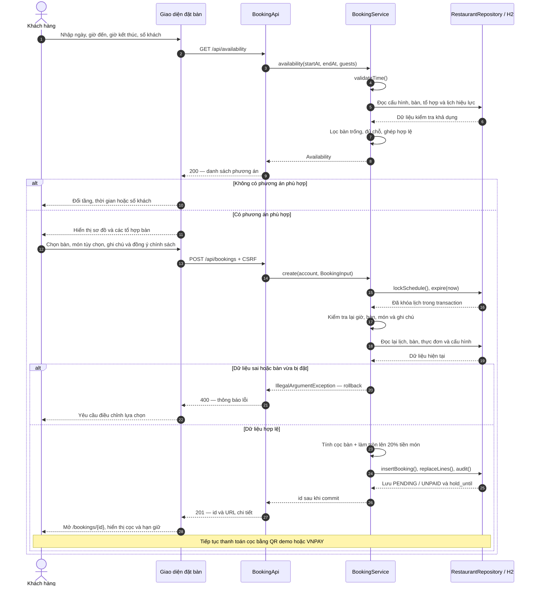
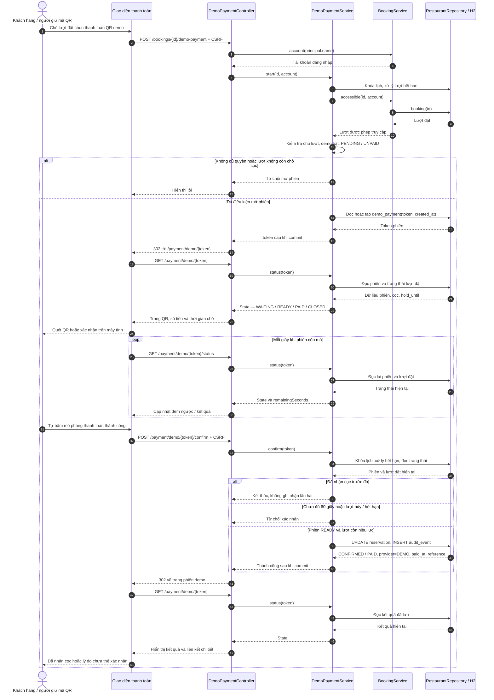

# Sequence diagram — chức năng đặt bàn GiaViên

Đối chiếu với mã nguồn ngày 07/10/2026. Phạm vi: tìm bàn → giữ bàn chờ cọc → xác nhận đặt bàn. Luồng mang về, nhận khách, đổi/hủy bàn và hoàn cọc không nằm trong sơ đồ chính.

## 1. Tìm và giữ bàn

**Tiền điều kiện:** khách đã đăng nhập và mở trang `/book`. `PageController.book()` nạp các món đang bán cho `book.html`; `booking.js` điều khiển tìm bàn và gửi lượt đặt.

Để sơ đồ dễ đọc, đối tượng `RestaurantRepository / H2` gộp lớp truy cập dữ liệu JDBC và database; đây không phải tên một lớp mới.

Các điểm khi đọc sơ đồ:

- Tìm bàn chỉ trả về khả dụng tại thời điểm tra cứu. Chỉ thao tác tạo lượt đặt mới giữ bàn.
- `create()` chạy trong transaction, khóa dòng `app_lock` bằng `SELECT ... FOR UPDATE`, rồi kiểm tra lại xung đột trước khi ghi. Các thao tác đọc trong sơ đồ được gộp để tránh lặp từng câu SQL.
- `validateTime()` kiểm tra 1–12 khách, thời gian tương lai, trong giờ phục vụ, kết thúc cùng ngày, ít nhất 30 phút, đặt trước tối đa 60 ngày. Nếu tra cứu có dữ liệu sai, API trả 400; phiên đăng nhập thiếu/hết hạn trả 401; CSRF không hợp lệ bị chặn trước controller.
- Số bàn bằng `ceil(số khách / 4)`, tối đa 3. Ghép bàn phải thuộc tổ hợp đã khai báo, liền nhau cùng tầng; kiểm tra lịch tính cả thời gian dọn bàn.
- Không bắt buộc đặt món. Nếu có, hệ thống kiểm tra món còn bán, số lượng 0–20/món và lưu tên/đơn giá tại lúc đặt.
- Tổng cọc = số bàn × cọc mỗi bàn + `ceil(tổng tiền món / 5)`. Mặc định cọc bàn là 100.000đ/bàn.
- `hold_until = min(now + holdMinutes, startAt)`; mặc định giữ 15 phút. Các bảng được ghi là `reservation`, `reservation_table`, `order_line`, `audit_event`.
- Sau 201, trình duyệt dùng `location.assign(data.url)` để GET chi tiết. `PageController.detail()` kiểm tra quyền và hiển thị lượt đặt.
- Nếu không thanh toán kịp, `expireHolds()` chạy mỗi 30 giây, khóa lịch rồi chuyển các lượt `PENDING` có `hold_until <= now` thành `EXPIRED`. Các luồng tạo/thanh toán cũng kiểm tra hết hạn; không phải đợi tác vụ định kỳ mới chặn được thanh toán trễ.

## 2. Xác nhận cọc bằng QR demo

**Tiền điều kiện:** luồng demo bật và VNPAY chưa được cấu hình. Mở phiên cần chủ lượt đăng nhập; người có token QR hợp lệ có thể mở/xác nhận phiên trên điện thoại mà không cần đăng nhập, vẫn cần CSRF cho POST.

- Tạo lại/mở lại cùng phiên không đặt lại mốc 60 giây.
- Quét QR, tải trang hoặc chờ đủ 60 giây không tự đánh dấu nhận cọc; người giữ mã phải chủ động bấm xác nhận.
- Lượt đặt chỉ chuyển từ `PENDING / UNPAID` sang `CONFIRMED / PAID` khi xác nhận hợp lệ. Đây là thanh toán mô phỏng.
- Polling trên các thiết bị khác đọc lại kết quả từ server. Chi tiết lượt đặt vẫn chỉ dành cho chủ lượt hoặc nhân viên.
- Khi VNPAY được cấu hình, nó thay luồng QR demo: `PageController.pay()` → `VnpayPaymentService.start()` → URL VNPAY đã ký. Chỉ IPN hợp lệ đi qua `BookingApi.ipn()` / `VnpayPaymentService.ipn()` mới ghi nhận cọc; browser return chỉ đọc kết quả. IPN thành công đến sau khi lượt hết hiệu lực ghi `REFUND_PENDING`, không khôi phục đặt bàn.

## Nguồn đối chiếu

- [Giao diện và request đặt bàn](../../src/main/resources/static/js/booking.js).
- [Endpoint tra bàn/tạo lượt đặt](../../src/main/java/vn/edu/giavien/web/BookingApi.java).
- [Nghiệp vụ khả dụng, kiểm tra và transaction](../../src/main/java/vn/edu/giavien/service/BookingService.java).
- [Quy tắc cọc và xung đột](../../src/main/java/vn/edu/giavien/domain/BookingPolicy.java).
- [Lớp truy cập database](../../src/main/java/vn/edu/giavien/data/RestaurantRepository.java).
- [Controller và trạng thái QR demo](../../src/main/java/vn/edu/giavien/web/DemoPaymentController.java), [nghiệp vụ demo](../../src/main/java/vn/edu/giavien/service/DemoPaymentService.java).
- [Nghiệp vụ VNPAY](../../src/main/java/vn/edu/giavien/service/VnpayPaymentService.java).
